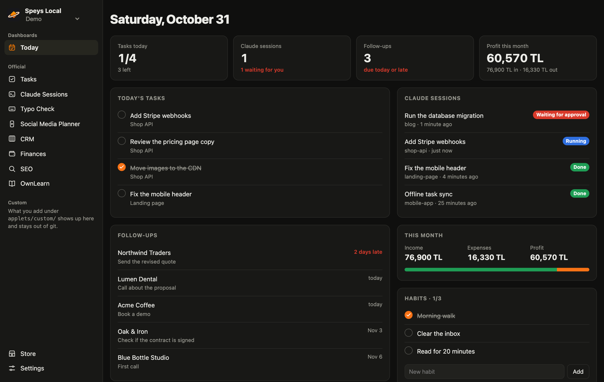
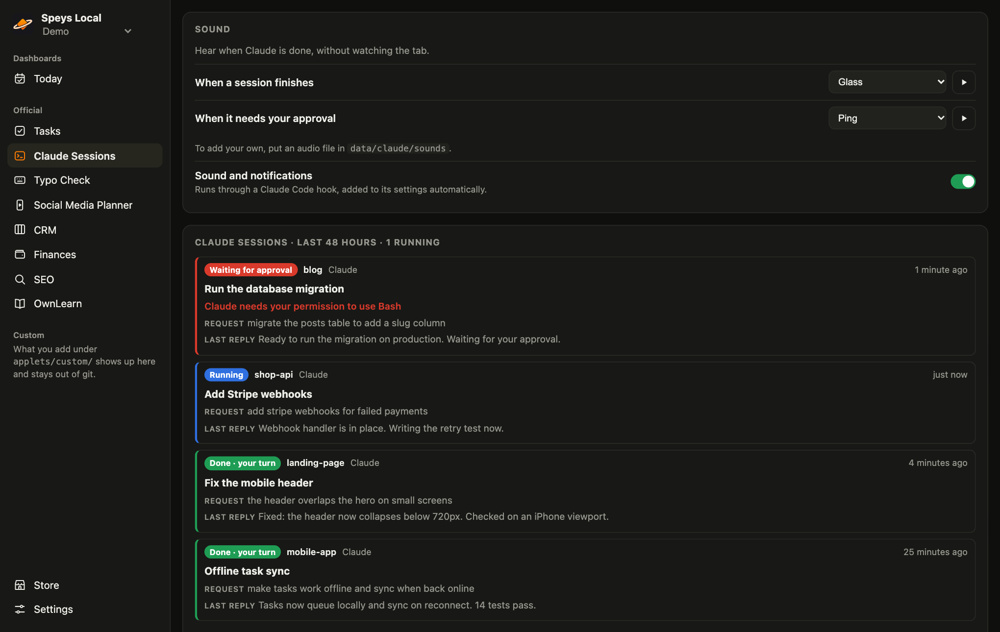
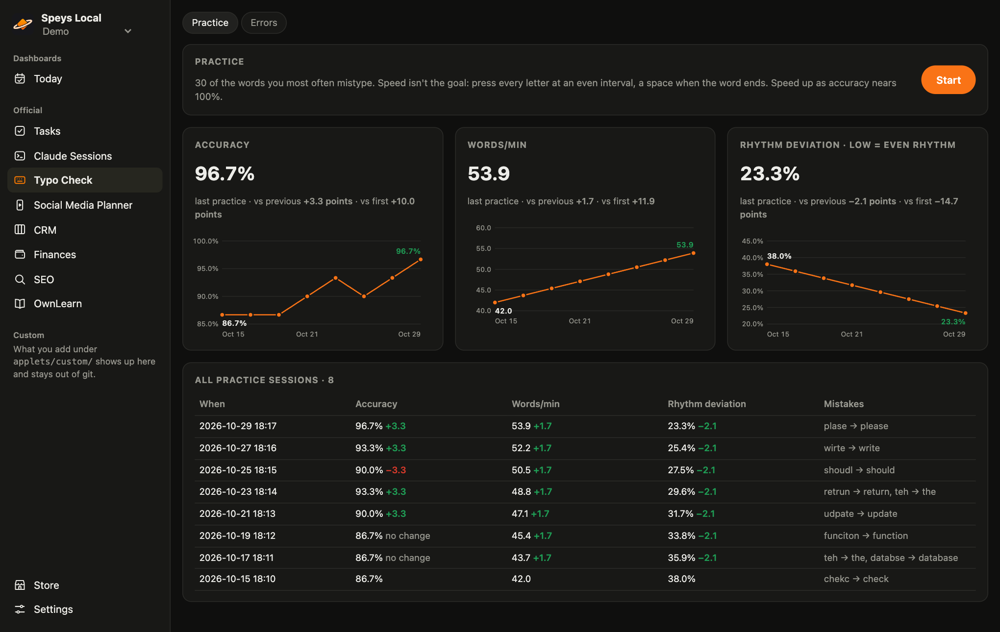
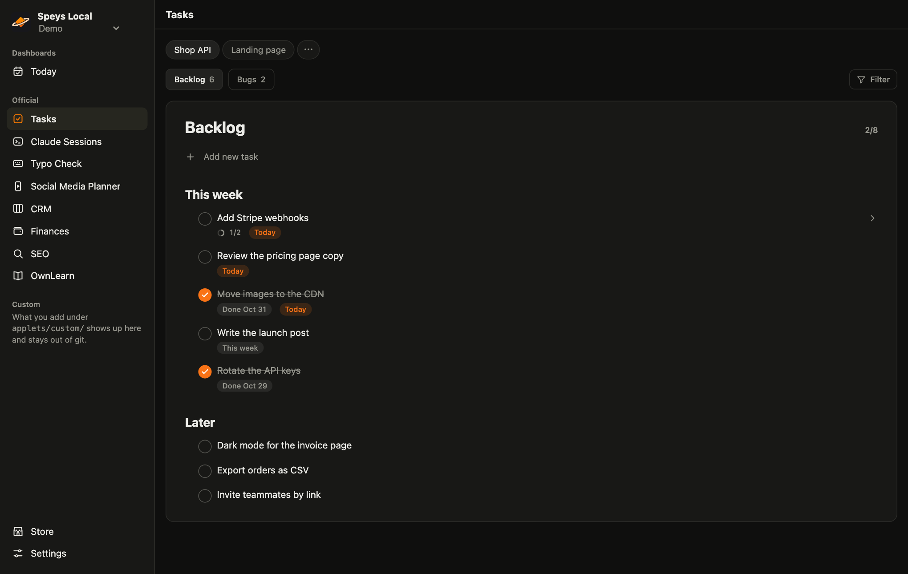
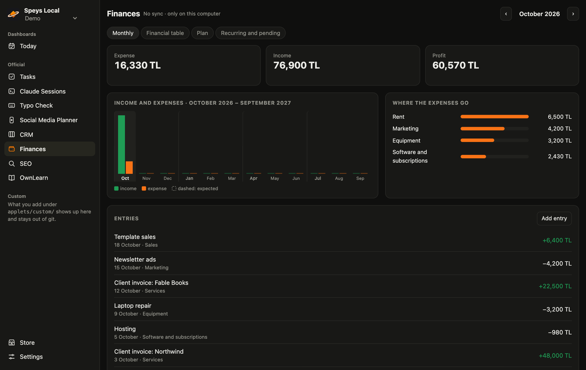
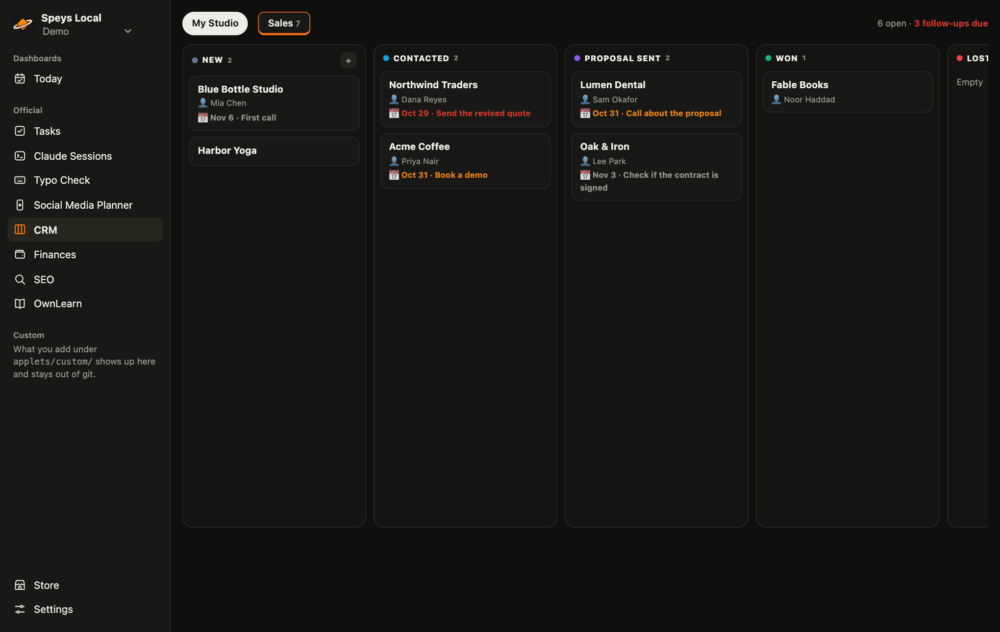

<div align="center">


# Speys Local

### Your own tools, on your own computer.

Your day on one screen: tasks, Claude sessions, follow-ups and money.<br>
Hear when Claude is done, and have it write the tool you're missing.

<p>
  
  
  
  
  
</p>

<a href="#-quick-start"><b>Quick start</b></a> ·
<a href="#-today"><b>Today</b></a> ·
<a href="#-claude-sessions"><b>Claude Sessions</b></a> ·
<a href="#-applets"><b>Applets</b></a> ·
<a href="#%EF%B8%8F-write-your-own"><b>Write your own</b></a> ·
<a href="CONTRIBUTING.md"><b>Contributing</b></a>

<br><br>

<picture>
  <source media="(prefers-color-scheme: light)" srcset="docs/images/today-light.png">
  
</picture>

</div>

## ☀️ Today

Open it and see what needs you: today's tasks, the Claude session waiting for approval, the follow-ups that are due, this month's profit, your habits. Every card comes from an applet, and a card you don't use simply isn't there. Dashboards get their own place at the top of the sidebar, so you can add more.

## 🔔 Claude Sessions

With a few Claude Code sessions open, it's easy to miss the one that finished. Speys Local tells you.

- **Pick your sound** for "session finished" and "needs your approval": your own audio file or a system sound, with a play button to try it.
- **Get a notification** when a job that took a while ends, so you can leave the tab.
- **See every session** on one screen: running, done, waiting for approval, with the last request and reply.



## 🚀 Quick start

Node 24 or newer is the only requirement.

```bash
git clone https://github.com/speys-app/speys-local.git
cd speys-local
node start.js          # http://localhost:3400
```

Start with the computer (macOS): `node start.js --install`, remove with `--uninstall`.
Update with the button in Settings, or `git pull`.

Settings and data live in `data/` next to the code. It stays out of git and updates don't touch it, but `git clean -x` would delete it, so don't run that here and keep your own backup. The interface comes in English and Turkish; pick the language in Settings.

**Just looking?** Pick **Demo** under the name in the sidebar: a workspace full of made-up data, rebuilt each time you open it.

### Claude hook

Session status, notifications and sound run on a Claude Code hook. Speys Local adds it to `~/.claude/settings.json` when you first open it: only its own entries, with a backup next to the file. Turn it off with the switch on the Claude Sessions page and it is removed.

Sound and notifications work on macOS for now. To add your own sounds, put audio files in `data/main/apps/claude/sounds/`.

## 🧩 Applets

Everything is an applet. Turn off what you don't need in Settings.

| | Applet | What it does | Needs |
|---|---|---|---|
| 🔔 | **Claude Sessions** | Your sessions at their desks in a little office, with status, notifications and sound | Claude hook |
| ⌨️ | **Typo Check** | The typos you make writing to Claude, and practice built from them | Claude Code logs |
| ✅ | **Tasks** | The md task lists in your projects, which Claude sees too; keep an eye on any repo's GitHub issues and pull requests | Project folders or a repo |
| 💰 | **Finances** | Income, expenses, recurring payments | Nothing |
| 🤝 | **CRM** | Deals and meetings: pipelines, stages, next steps | Nothing |
| 🎬 | **Social Media Planner** | Content calendar: accounts, videos, posts, numbers | A folder with `takvim.json` |
| 🔍 | **SEO** | Search Console, post checks, search previews | Your sites |
| 📚 | **OwnLearn** | Learn SQL from your own repo's code | A repo path |

<table>
  <tr>
    <td width="50%"><p align="center"><b>Typo Check</b></p></td>
    <td width="50%"><p align="center"><b>Tasks</b></p></td>
  </tr>
  <tr>
    <td width="50%"><p align="center"><b>Finances</b></p></td>
    <td width="50%"><p align="center"><b>CRM</b></p></td>
  </tr>
</table>

<sub>Screenshots use made-up data.</sub>

## 🛠️ Write your own

Tell Claude what you want: *"add an applet under `applets/custom/` that does this."* What you add there stays out of git, and updates don't touch it. Add `"dashboard": true` to `applet.json` to put it at the top of the sidebar. The smallest applet is two files:

```
applets/custom/my-notes/
  applet.json    { "name": "My notes", "icon": "icon.svg" }
  index.html     your page
```

| Folder | What goes there | In git |
|---|---|---|
| `applets/official/` | Applets that ship to everyone | Yes |
| `applets/store/` | Applets installed from the Store | No |
| `applets/custom/` | Applets on this computer only; a copy with the same id replaces an official one | No |

## 🏪 Store

Applets written by other people, one click to install. Every version is reviewed before it's listed, and nothing updates by itself. Wrote one? [Send it in](CONTRIBUTING.md#store).

## 🗂️ Workspaces

A workspace is its own settings and data: keep work and personal apart, or a client on its own. Switch or add one from the name in the sidebar. Each one is a folder in `data/`.

## 🔒 Your data stays here

The server binds to `127.0.0.1` and sends nothing out. It goes on the network only when you ask: the update button, and services you connect, like Search Console.

## 🤝 Contributing

Code and interface text are in English, and translations are optional, so you don't need another language to contribute. See [CONTRIBUTING.md](CONTRIBUTING.md).

Run the tests with `npm test`.

## 📄 License

[MIT](LICENSE). The Typo Check word lists are under CC BY-SA 4.0; see [their notice](applets/official/yazim/sozluk/README.md).
