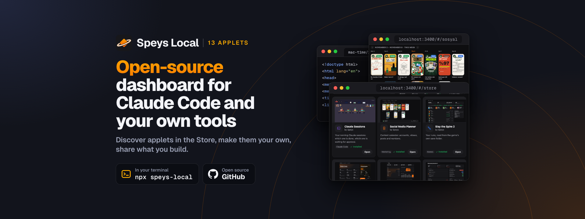
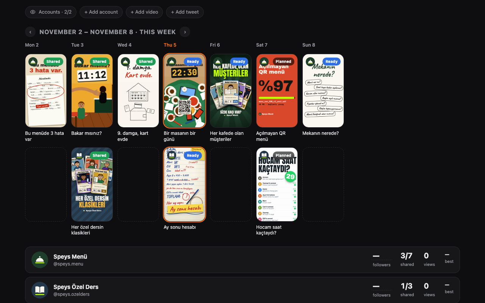

<div align="center">



# Speys Local

### Open-source dashboard for Claude Code and your own tools

Discover applets in the Store, make them your own, share what you build.

<p>
  
  
  
  
  
</p>

<a href="#-quick-start"><b>Quick start</b></a> ·
<a href="#-claude-reaches-everything"><b>Why local</b></a> ·
<a href="#-whats-inside"><b>Applets</b></a> ·
<a href="#-store"><b>Store</b></a> ·
<a href="#%EF%B8%8F-write-your-own"><b>Write your own</b></a> ·
<a href="CONTRIBUTING.md"><b>Contributing</b></a>

</div>

## 💡 What it is

Most of us live on our laptop screens. When I build, I keep notes for Claude in plain md and txt files, and next to that I use, or build, tools made for one job: a task system, a social media planner.

Speys Local puts the two together. It collects the tools I use on my own computer in one open-source place: md-based tasks, research for videos, a planner to keep posting on track and more. I put up the first ones. From there, tune them to how you work, send improvements, and add the tools you use to the Store.

## 🤖 Claude reaches everything

Speys Local runs on your computer, so the app and your data are plain files in one folder: pages are HTML, settings are JSON, task lists are markdown. Claude Code works in that same folder and reads and changes all of it.

- **No migrations, no deploys.** Ask Claude for a change and use it right away; a page reloads by itself when its file is saved.
- **Your data stays on your computer.** No account and no server of ours; the app only listens on `127.0.0.1`.
- **Every applet is a folder you can read.** An `applet.json`, an HTML page, and a backend file if it needs one:

```
applets/store/mac-time/
  applet.json    name, icon, what it reads
  index.html     the page
  backend.js     optional: reads files, answers the page
```

## 🧩 What's inside

<table>
  <tr>
    <td width="50%"><p align="center"><b>Social Media Planner</b></p></td>
    <td width="50%"><p align="center"><b>Slay the Spire 2</b></p></td>
  </tr>
  <tr>
    <td width="50%"><p align="center"><b>Claude Sessions</b></p></td>
    <td width="50%"><p align="center"><b>Claude Wrapped</b></p></td>
  </tr>
  <tr>
    <td width="50%"><p align="center"><b>Mac Time</b></p></td>
    <td width="50%"><p align="center"><b>SEO</b></p></td>
  </tr>
</table>

<sub>Screenshots use made-up data; the video covers in the planner are from our own accounts.</sub>

| | Applet | What it does | Needs |
|---|---|---|---|
| ✅ | **Tasks** | Reads the tasks you write in md files in any folder, so a company's tasks can live in that company's repo. Comes with a GitHub issues integration; more syncs are welcome as contributions | Project folders or a repo |
| 🔔 | **Claude Sessions** | Your sessions at their desks in a little office; a sound when one finishes or needs your approval; what each one read, changed and opened | Claude hook, session logs |
| ☀️ | **Today** | Your day on one screen: tasks, the session waiting for you, follow-ups, this month's numbers | Nothing |
| 🎬 | **Social Media Planner** | Content calendar: accounts, videos and their covers, posts, numbers | Nothing |
| 🤝 | **CRM** | Deals and meetings: pipelines, stages, next steps | Nothing |
| 💰 | **Finances** | Income, expenses, recurring payments | Nothing |
| 🔍 | **SEO** | Google Search Console, post checks, search previews | Your sites |
| 📚 | **OwnLearn** | Scans a repo and teaches you the concepts in its code; SQL for now | A repo path |
| ⌨️ | **Typo Check** | Finds the typos you make writing to Claude and builds practice from them; works best in Turkish for now | Claude Code logs |
| 🎁 | **Claude Wrapped** | Your month with Claude Code in numbers, and a card to share | Claude Code logs |
| 🗂️ | **Claude Files** | What has piled up in your Claude folders, read-only | Claude Code folders |
| ⏱️ | **Mac Time** | How long this Mac was in use today, and in which apps | macOS |
| 🗡️ | **Slay the Spire 2** | Your runs, read from the game's own save folder | The game |

## 🏪 Store

Every applet lives in this repo and shows up in the Store, with screenshots and what it reads. A new install comes with Today, Tasks and Claude Sessions; the rest is one click away. Installing adds an applet to the sidebar: nothing is downloaded, and an applet you haven't installed runs no code. Removing one keeps its data.

Every applet is reviewed before it's added, and updates with Speys Local only when you click. Built something you use every day? [Send it in](CONTRIBUTING.md#store).

## 🚀 Quick start

You need Node 24 or newer and git.

```bash
npx speys-local        # http://localhost:3400
```

The first run clones the repo to `~/speys-local`; run the same command to open it again. Or do it yourself:

```bash
git clone https://github.com/speys-app/speys-local.git
cd speys-local
node start.js
```

Start with the computer (macOS): `node start.js --install`, remove with `--uninstall`.
It checks GitHub once an hour and asks when there is an update; nothing installs without your click. Turn the check off in Settings. You can also update with `git pull`.

Settings and data live in `data/` next to the code. It stays out of git and updates don't touch it, but `git clean -x` would delete it, so don't run that here and keep your own backup. The interface comes in English and Turkish; pick the language in Settings.

**Just looking?** Pick **Demo** under the name in the sidebar: a workspace full of made-up data, rebuilt each time you open it.

Speys Local is built and tested on macOS. It hasn't been tried on Windows or Linux yet, so expect rough edges there; sound and notifications work on macOS for now. If you try it elsewhere, tell us where it breaks.

### Claude hook

Session status, notifications and sound run on a Claude Code hook. Speys Local adds it to `~/.claude/settings.json` when you first open it: only its own entries, with a backup next to the file. Turn it off with the switch on the Claude Sessions page and it is removed. If you delete the folder first, the entry stays in the settings file but does nothing. Speys Local comes with 13 sounds of its own; to add yours, put audio files in `data/apps/claude/sounds/`.

### Uninstall

Turn the hook off on the Claude Sessions page, run `node start.js --uninstall` if you set up autostart, then delete the folder. Your data is in `data/` inside it, so move that out first if you want to keep it.

## 🛠️ Write your own

Tell Claude what you want: *"add an applet under `applets/custom/` that does this."* It shows up in the sidebar by itself. What you add there stays out of git, and updates don't touch it. The smallest applet is two files:

```
applets/custom/my-notes/
  applet.json    { "name": "My notes", "icon": "icon.svg" }
  index.html     your page
```

To change a Store applet for yourself, copy it to `applets/custom/` under the same id: your copy replaces it.

| Folder | What goes there | In git |
|---|---|---|
| `applets/store/` | Every applet that ships to everyone, listed in the Store | Yes |
| `applets/custom/` | Applets on this computer only; a copy with the same id replaces the Store one | No |

## 🗂️ Workspaces

A workspace is its own settings and data: keep work and personal apart, or a client on its own. Switch or add one from the name in the sidebar. Each one is a folder next to `data/`.

## 🔒 Your data stays here

The server binds to `127.0.0.1` and sends nothing out. It goes on the network for the hourly update check, a `git fetch` you can turn off in Settings, and when you ask: the update button, services you connect like Search Console or a GitHub repo, and the SEO applet's button that sends a page address to validator.schema.org. The Slay the Spire 2 applet loads character art from spire-codex.com; every applet's Store page says what it reads.

## 🧰 In VS Code

[Speys Tools](https://github.com/speys-app/speys-vscode) is our VS Code extension for working across many repos: one key moves Source Control, the terminal and the Explorer to another project, and files go from the Explorer to Claude Code with a right click. It's a separate install, and Speys Local doesn't need it.

## 🤝 Contributing

Improve an applet, add a sync to Tasks, or send the tool you use to the Store. Code and interface text are in English, and translations are optional, so you don't need another language to contribute. See [CONTRIBUTING.md](CONTRIBUTING.md).

Run the tests with `npm test`.

More from Speys: [speys.app](https://speys.app/).

## 📄 License

[MIT](LICENSE). The Typo Check word lists are under CC BY-SA 4.0; see [their notice](applets/store/yazim/sozluk/README.md).
